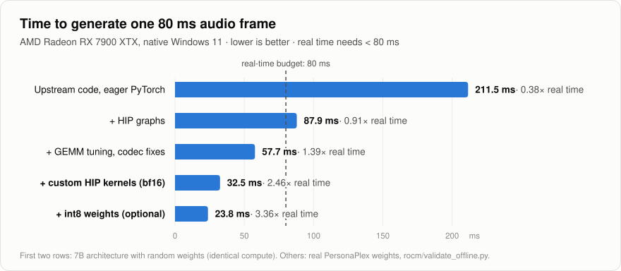

<h1 align="center">PersonaPlex on AMD Radeon · native Windows</h1>

<p align="center">
  <b>Real-time, full-duplex voice AI that you can interrupt mid-sentence.</b><br>
  NVIDIA's <a href="https://github.com/NVIDIA/personaplex">PersonaPlex-7B</a> running on an AMD Radeon RX 7900 XTX under Windows 11.<br>
  No CUDA, no WSL, no Visual Studio.
</p>

<p align="center">
  <a href="LICENSE"></a>
  
  
  
  
  <a href="https://github.com/HrMarcussen/personaplex-rocm/actions/workflows/ci.yml"></a>
</p>

<p align="center">
  <picture>
    <source media="(prefers-color-scheme: dark)" srcset="docs/assets/benchmark-dark.svg">
    
  </picture>
</p>

PersonaPlex listens and speaks at the same time: NVIDIA reports it taking the turn in about 0.2 s,
it backchannels ("mm-hm") while you talk, and it stops when you interrupt it. You give it a voice and
a role in plain text. It was released for NVIDIA GPUs; on an AMD card under Windows its reference
code ran at 0.38x real time, far too slow to talk to. This project makes it **2.5x faster than real
time** on an RX 7900 XTX (3.4x with optional int8 weights) while keeping NVIDIA's reference code,
model, and web UI.

## Highlights

- **Real time with headroom:** 32.5 ms to produce each 80 ms of speech (bf16), 23.8 ms with int8.
  A 45 s live session over the websocket kept pace with zero drift.
- **The real thing, not a re-implementation:** NVIDIA's PyTorch code and web UI with a focused set
  of patches. Every optimization is checked against the original code path (bit-identical audio
  codec tokens, token-identical greedy decoding for the first 6.7 s of a conversation).
- **Zero extra toolchain:** AMD's official PyTorch-on-Windows wheels. The custom GPU kernels are
  compiled by the clang that ships inside AMD's ROCm SDK wheel and loaded through the HIP runtime,
  so no MSVC, CUDA, or WSL is needed.
- **Optional int8 weights:** ~13 GB of VRAM in use instead of ~18.4 GB, which should let 16 GB
  Radeon cards run it (untested on such cards so far).
- **Safe fallbacks:** the custom kernels and GEMM tuning only switch on with ROCm; if the kernels
  cannot load, the stock PyTorch operations are used automatically.

## Quick start

**You need:** Windows 11 · an AMD Radeon RX 7000 (RDNA3) or RX 9000 (RDNA4) GPU with ≥ 20 GB VRAM
(16 GB cards: use int8, untested) · AMD Adrenalin driver 26.2.2 or newer · [Python 3.12](https://www.python.org/downloads/)
(with the `py` launcher) · ~40 GB free disk · a free [Hugging Face](https://huggingface.co/join) account.

1. **Accept the model license.** Log in to Hugging Face, open
   [nvidia/personaplex-7b-v1](https://huggingface.co/nvidia/personaplex-7b-v1) and click
   **Agree and access repository**.
2. **Install** (downloads ~10 GB of ROCm + PyTorch wheels):
   ```powershell
   git clone https://github.com/HrMarcussen/personaplex-rocm.git
   cd personaplex-rocm
   powershell -ExecutionPolicy Bypass -File rocm\install.ps1
   ```
3. **Log in to Hugging Face once.** Create a *Read* token at
   [huggingface.co/settings/tokens](https://huggingface.co/settings/tokens) and paste it when asked
   (the input is hidden):
   ```powershell
   .\.venv\Scripts\huggingface-cli.exe login
   ```
4. **Start the server.** The first start downloads the 16.7 GB model and tunes GPU kernels for your
   card (a few minutes); later starts take under a minute:
   ```powershell
   powershell -ExecutionPolicy Bypass -File rocm\run-server.ps1
   ```
5. **Talk.** Open **http://localhost:8998** in Chrome or Edge, allow the microphone, pick a voice and
   a role, press *Connect*, and start talking. Interrupt it whenever you like.

> [!TIP]
> Use `localhost` exactly: browsers only grant microphone access on `localhost` or over https.
> The browser's echo cancellation is on, but headphones give the cleanest interruptions.

## Using it

| | |
|---|---|
| **Voices** | 18 built-in voices: natural `NATF0-3` / `NATM0-3` and more varied `VARF0-4` / `VARM0-4` (F = female, M = male). |
| **Roles** | Free text, e.g. `You enjoy having a good conversation.` or `You work for AeroRentals Pro and your name is Tomaz…`. See NVIDIA's [prompting guide](UPSTREAM_README.md#prompting-guide). |
| **Language** | English. The model was trained on English conversations only. |
| **int8 mode** | `$env:PERSONAPLEX_INT8 = "1"` before starting the server: faster, ~13 GB VRAM instead of ~18.4 GB. Compare the sound on your setup; it is opt-in. |
| **Offline** | wav in, wav out: `.\.venv\Scripts\python.exe -m moshi.offline --voice-prompt NATF2.pt --input-wav in.wav --output-wav out.wav --output-text out.json` |
| **Remote access** | `run-server.ps1 -HostName 0.0.0.0` plus `--ssl <dir with key.pem and cert.pem>`, because browsers need https for the mic on other machines. |

## Performance

Measured on an RX 7900 XTX (Windows 11, driver 32.0.32015, ROCm 7.2.1, PyTorch 2.9.1), time to
produce one 80 ms audio frame:

| Configuration | Mean | Worst | vs. real time |
|---|---:|---:|---:|
| NVIDIA's code on ROCm PyTorch, eager ¹ | 211.5 ms | – | 0.38x |
| + HIP graphs (upstream's CUDA-graph code works on ROCm) ¹ | 87.9 ms | – | 0.91x |
| + TunableOp GEMM tuning, duplicate codec removed, codec graphs | 57.7 ms | 60.6 ms | 1.39x |
| **+ custom HIP kernels (default)** | **32.5 ms** | **34.9 ms** | **2.46x** |
| + int8 weights (`PERSONAPLEX_INT8=1`) | 23.8 ms | 24.7 ms | 3.36x |

¹ Measured with the same 7B architecture and random weights (identical compute); all other rows on
the real PersonaPlex weights.

Over a real-time websocket session (`rocm/ws_client_test.py`, 45 s of speech) the server never fell
behind (0 ms drift), with a constant 0.215 s audio round trip, of which ~160 ms is inherent to the
model (80 ms frames plus one frame of acoustic delay). Rows 3-5 and the live session can be
reproduced with the scripts in [`rocm/`](rocm/); rows 1-2 were measured on the unmodified upstream
code during development (see [docs/TECHNICAL.md](docs/TECHNICAL.md)).

## How it works

Generating speech token by token is dominated by memory traffic: every 80 ms frame streams all
~16 GB of weights through the GPU once, as thousands of small operations. On top of AMD's PyTorch
wheels this project:

1. **Graph-captures** each step with HIP graphs. That includes whole Mimi codec steps, whose
   streaming state was made to update in place.
2. **Tunes GEMMs** with PyTorch TunableOp and removes a second codec instance whose output was
   always discarded.
3. **Adds custom HIP kernels:** batch-1 GEMV that streams weights at ~850–885 GB/s (the stock
   kernels reach 150–500 GB/s on these shapes), fused RoPE + ring KV-cache write + split-K decode
   attention, fused RMSNorm, and optional int8 GEMV. Each kernel is autotuned per shape against
   PyTorch and only used where it wins.
4. **Fixes a Windows timing trap:** `asyncio.sleep(0.001)` really sleeps ~15 ms at Windows' default
   timer resolution; the server now requests 1 ms.

The kernels are header-free HIP compiled device-only by the ROCm SDK's bundled clang, loaded with
`hipModuleLoadData` and launched through `hipModuleLaunchKernel` on PyTorch's stream, so graph
capture records them like any other kernel. Details, design notes, and validation in
**[docs/TECHNICAL.md](docs/TECHNICAL.md)**.

## Compatibility

| | Status |
|---|---|
| RX 7900 XTX (gfx1100), Windows 11 | ✅ tested |
| Other RDNA3 / RDNA4 cards (gfx1100–1102, gfx1150/1151, gfx1200/1201) | 🟡 kernels are built for them; untested |
| 16 GB cards with `PERSONAPLEX_INT8=1` | 🟡 should fit (13.0 GB measured in use); untested |
| Linux with ROCm | 🟡 code paths are cross-platform; untested |
| NVIDIA GPUs | ➡️ use [NVIDIA/personaplex](https://github.com/NVIDIA/personaplex); the custom kernels here are AMD-only |

Reports for other cards are very welcome: please open an issue with your numbers from
`rocm\bench_step.py --random`.

## FAQ

<details>
<summary><b>Can it speak Danish, German, …?</b></summary>

No. PersonaPlex was trained on English conversations only. Supporting another language would need
fine-tuning on (largely synthetic) two-speaker dialogue in that language.
</details>

<details>
<summary><b>Could I run this in LM Studio / llama.cpp / Ollama?</b></summary>

No. Those run text LLMs. PersonaPlex is a speech-to-speech model with an audio codec, a second
"depth" transformer that emits 16 audio tokens per step, and a live two-way audio protocol.
</details>

<details>
<summary><b>"custom HIP kernels unavailable" in the log?</b></summary>

The server falls back to stock PyTorch (~58 ms per frame, still real time on an RX 7900 XTX).
Check that the ROCm SDK wheels installed correctly (`rocm\install.ps1`), and include the message in
an issue. `PERSONAPLEX_KERNELS=0` forces the fallback.
</details>

<details>
<summary><b>The browser shows no microphone prompt.</b></summary>

Open `http://localhost:8998` (not your LAN IP), in Chrome or Edge, and check Windows' microphone
privacy settings for the browser.
</details>

<details>
<summary><b>Does this need the model weights from this repo?</b></summary>

No weights are included. They are downloaded from Hugging Face under the NVIDIA Open Model License
after you accept it.
</details>

## Credits and license

- [**PersonaPlex**](https://github.com/NVIDIA/personaplex) by NVIDIA: code under MIT; model weights under
  the [NVIDIA Open Model License](https://www.nvidia.com/en-us/agreements/enterprise-software/nvidia-open-model-license/)
  (not included here).
- [**Moshi**](https://github.com/kyutai-labs/moshi) by Kyutai and **Audiocraft** by Meta, which PersonaPlex
  builds on (MIT).
- AMD's [ROCm PyTorch wheels for Windows](https://rocm.docs.amd.com/projects/radeon-ryzen/en/latest/).
- Related: [gain774/moshi-rocm](https://github.com/gain774/moshi-rocm), a HIP build of the C++
  `moshi.cpp` engine for Linux.

This port is released under the [MIT License](LICENSE); see [NOTICE.md](NOTICE.md) for third-party
notices. It is an independent community project and is **not affiliated with, endorsed by, or
supported by NVIDIA or AMD**. NVIDIA's original README is in [UPSTREAM_README.md](UPSTREAM_README.md).
